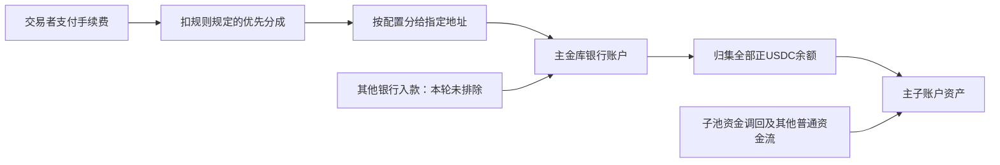

# MegaVault：协议分成与账户增量原件核验

**本轮结论：已核实一个具体赚钱机制——主MegaVault银行地址在所查两个历史块均被配置为领取特定手续费基数的5%。但尚未核齐实际银行收款与扫入记录，不能把账户的426.065316 USDC观察增量全部写成手续费收入或完整净利润。** 这份证据解释的是指定地址的收入分配权，不是价格预测模型的优势；个人多挂单或换更强模型，不会自动把自己的地址加入这份配置。

仍只研究，不运行模型、回测、策略或来源代码/SDK/SQL/EVM，不交易、不连接账户、不读凭证、不注册、不安装、不付费、不外发、不改监控。读取日为北京时间2026-10-17，直接公开读取实际UTC约17:37—17:46；逐件回执保留请求/完成时刻、原URL、HTTP、原响应与SHA-256。网页抽取准确请求秒数UNKNOWN，不把保存时刻冒成读取时刻。

**固定范围与版本。** 沿用UTC2026-10-01含至10-02不含，不按表现换市场或日期。为交叉核对采用此前已确定的两侧上下文块107552133（9月30日23:00:54.608Z）和107696209（10月2日00:35:20.252Z），它们不是精确零点，不将上下文结果写成该日精确收益。官方升级表声明105002000起为v9.7.0；本次官方tag实际绑定commit `67a3c71670c460ef92ffb15930dda7047a901f64`，按该版本读取收入规则。tag和声明仍不替代独立共识/应用构建证明。[官方升级表](https://docs.dydx.xyz/nodes/resources)

**1．谁付钱，为什么会进主金库。**

已读v9.7.0源码显示：

- 起点是主动吃单者与被动挂单者的手续费之和，不是成交额。
- 有介绍方分成时先扣该部分；无介绍方时扣适用订单路由方分成，剩余正基数再按配置ppm计算指定地址的份额。ppm是百万分之一，50000ppm=5%。
- 撮合处理计算分成后调用DistributeFees；费用计算出错可走空份额分支，配置存在不等于每笔交易必已付款。
- TransferFees将对应USDC从抵押池银行账户发送给指定地址；之后主金库的银行余额通过Sweep扫入其主子账户。这里Sweep是把同币的全部正银行余额归集入账，不是只扫协议分成。

[费用基数与份额源码](https://github.com/dydxprotocol/v4-chain/blob/67a3c71670c460ef92ffb15930dda7047a901f64/protocol/x/revshare/keeper/revshare.go)[撮合调用](https://github.com/dydxprotocol/v4-chain/blob/67a3c71670c460ef92ffb15930dda7047a901f64/protocol/x/clob/keeper/process_single_match.go)[实际付款与存入](https://github.com/dydxprotocol/v4-chain/blob/67a3c71670c460ef92ffb15930dda7047a901f64/protocol/x/subaccounts/keeper/transfer.go)[银行余额归集](https://github.com/dydxprotocol/v4-chain/blob/67a3c71670c460ef92ffb15930dda7047a901f64/protocol/x/vault/keeper/sweep_funds.go)

这是公开代码机制图，不是已核齐的期间收款总账。源码中的unconditional是配置类别名称，不表示保本、固定收益或任意个人都可领取。代码中“Emit revenue share”实际调用metrics遥测，不能把它当专用链上收入事件。

**2．5%是实际历史状态，不是旧文章的50%。**

本次实际请求 `/dydxprotocol/revshare/unconditional_rev_share`，分别指定上述两块高度；HTTP均200、响应metadata与请求高度相同、原body均253B且SHA相同。记录包含：

|收款地址|share_ppm|可确认含义|
|---|---:|---|
|主MegaVault：dydx18tkxrnrkqc2t0lr3zxr5g6a4hdvqksylxqje4r|50000|两块的指定地址份额均5%。|
|另一地址|50000|未核其经济归属，不猜机构或个人身份。|
|另一地址|750000|同上，不把它叫平台利润。|

两快照不证明期间从未调参，也不证明每笔基数、舍入或实际付款。不把5%当当前永久比例、平台全部毛费比例或个人收益率；旧材料50%不能直接用于这一账期。[官方状态查询定义](https://github.com/dydxprotocol/v4-chain/blob/67a3c71670c460ef92ffb15930dda7047a901f64/proto/dydxprotocol/revshare/query.proto)[地址与份额字段](https://github.com/dydxprotocol/v4-chain/blob/67a3c71670c460ef92ffb15930dda7047a901f64/proto/dydxprotocol/revshare/revshare.proto)

本地原件：root/unconditional-share-before/after.original.json；原响应SHA均为0030682c9eb79cfa8d910aa987c478285a19215287b427f5ff373b925434e0ee。节点是官方文档列出的Polkachu公共提供商，不因此称基金会亲自运营或对数据担保。

**3．真实账户增量：从余额与783条普通转账核起。**

已取得两历史高度的主子账户原状态，metadata匹配。两点均只有asset_id0资产、perpetual_positions为空；quote最小单位按既有官方−6精度换算，数额与相同块高indexer equity精确对应。只证明这两个状态点，不推所有中间状态。

|项目|USDC计价金额|
|---|---:|
|起点主子账户资产|1515567.246150|
|终点主子账户资产|1515578.264891|
|资产增加|11.018741|
|索引中流入合计，779条|130.862669|
|索引中流出合计，4条|545.909244|
|索引普通净转入|−415.046575|
|资产变化减普通净转入|**426.065316**|

取得的普通转账页是limit1000、page1、offset0；服务实际接受1000，不能仅由源码默认1000推断允许。该页1000条无重复ID，块高降序、最早107486405早于上下文起点，按107552133<h<=107696209筛到783条、7个交易哈希，symbol均USDC；前100条与之前独立取得的固定日截止页ID相同。对于该索引返回的排序与数据，这页覆盖所选上下文；它不证明供应商保留完整或银行路径也被收进普通transfer。

779条流入中，776条、90.612669 USDC的发送地址与既有195个子金库状态地址一致；另3条、40.25来自其他地址，未将其资金性质直接称收入。四条流出合545.909244。内部子池划转不算系统新增收入；其他地址入款也须先核资金性质。本次没有把末条tick的netTransfers字段直接当整个区间合计，而是逐笔求和。[主账户转账公开入口](https://indexer.dydx.trade/v4/transfers?address=dydx18tkxrnrkqc2t0lr3zxr5g6a4hdvqksylxqje4r&subaccountNumber=0&limit=1000&page=1&createdBeforeOrAtHeight=107696209%29[固定版本主子账户查询定义](https://github.com/dydxprotocol/v4-chain/blob/67a3c71670c460ef92ffb15930dda7047a901f64/proto/dydxprotocol/subaccounts/query.proto)

**426.065316目前的准确名称是“扣除已索引普通资金流后的账户观察增量”。** 它与协议分成归集路径相容，但尚未排除其他银行入款或未索引路径，也没有取得全部费用原账、银行余额及整体子池盈亏，不能称完整净利润。

**4．累计PnL相同不是第二份独立盈利证明。**

同一上下文26条历史PnL的totalPnl从8074622.910008变为8075048.975324，差同426.065316。固定官方indexer源码的calculateTotalPnl就是：

`totalPnl = 当前equity − 历史普通净transfers`

netTransfers记录相邻tick之间的USDC转账，不是自本次起点累计。因此上面的差额对应是同一会计定义的结果，不能当独立交叉审计或当所有来源均已归因。本次另有归档节点资产状态核对应金额，但它仍不能替代漏掉的收款来源。[PnL计算源码](https://github.com/dydxprotocol/v4-chain/blob/50d70ca0f151a6a40f9fa62438d6d85b583d710c/indexer/services/roundtable/src/helpers/pnl-ticks-helper.ts)[生成任务](https://github.com/dydxprotocol/v4-chain/blob/50d70ca0f151a6a40f9fa62438d6d85b583d710c/indexer/services/roundtable/src/tasks/create-pnl-ticks.ts)

这些indexer源码固定于当前commit50d70ca…，并未证明服务部署字节；与观测数据一致也不自动证明部署身份。链规则源码则另固定v9.7.0，两种身份没有混用。

**5．原始区块能证实一次赎回，尚未补齐分成收入。**

按此前已选定的转账哈希E5AC87055CD4CFBB10A05C4A6F3F40910CDC2CF9518C798A6BA0F3C827686C4A的块107688409，实际取得历史block_results与block原件，均HTTP200。区块header明确chain_id=dydx-mainnet-1，时间与索引该笔时间对应；block.data.txs实际6条。仅对序列化交易Base64字节做SHA-256指纹，将E5AC绑定index2，原result code0。原withdraw_from_megavault事件redeemed_quote_quantums=505661256，与普通索引出款505.661256 USDC对应，另有份额字段。

这说明一次真实按份额赎回成功，**505.661256是赎回金额，不是利润**；未核持有人全部申购成本、持有期与收益。原交易还出现独立计费的coin_spent记录，付款地址与赎回者一致；本轮未另外核计费denom元数据或换算美元，不把池的账面收入直接当个人净到手。

该单块的明文事件中未见主银行地址收款或Sweep；这只是固定单块的有限观察，不能推整个期间没有分成。另对同一上下文按main银行地址、coin_received.receiver索引请求最早一条原收款，25秒读取超时，未取得正文；0保存字节不是0条匹配，方法是否获服务完成也UNKNOWN。停止这条查询，没有重试、改身份/代理/host、安装SDK或触碰已被拒的BTC成交页。

本次为普通HTTP读取已完成区块数据的RPC接口，不是eth_call、trace、合约执行、模拟、广播或交易。官方旧RPC文档地址只重定向到总览，不能当方法支持证据；block/block_results支持由实际成功响应确认，tx_search则保留未知。

**本地解析错误已纠正。** 节点事件attribute已经是明文，初始启发式Base64解码误读了一个module字段。原响应未变；错误派生保留并明确作废，正确派生直接复制全部原字符串。余额/资金流计算未依赖坏字段。初始通用摘要曾读不存在的顶层txs得到0，实际交易数以block.data.txs的6条为准，不能当空块。见root/event-parser-correction.json及withdrawal-block-hash-binding.json，独立审阅按原件复核。

**6．对你“能不能复制赚钱环节”的实际含义。**

|环节|能借鉴什么|目前不能据此得到什么|
|---|---|---|
|收入分拆与原账核对|用公开状态及逐笔资金流，区分内部调拨、其他资金流和待归因增量；低成本可做。|API累计PnL或账户收款不自动变成完整净利润。|
|指定地址分成|代码和实际配置能说明业务收入如何分配。|你个人挂单或模型更强，不会自动获得主MegaVault那一项5%配置；改配权限本轮未完整审阅，不称任意个人可领取。|
|持有金库份额|原赎回事件证明存在按份额退出的机制。|不是复制独立交易优势；你的准入、数据/部署许可、存取成本、全部池风险与收益分配细则尚未核齐。|
|规模与财富目标|应先证明可重复净优势及自己可获得的收入权，再谈容量。|不能用426除当前主账户资金算回报、不能426÷5%反推已核平台手续费，也不能给5000美元或几十万美元的盈利规模。|

教学示例：假设某次规则允许分配的手续费为100 USDC，指定金库份额为5%，该次规则计算给池5 USDC；若某人依法取得池的1%经济份额，他对应这项收入的毛份额才是0.05 USDC。这里只演示分配与稀释，未计其他损益/费用，不是MegaVault真实收益、个人可交易资格或回报承诺。

**本样本继续保留，尚不准入为公开完整扣费盈利案例。** 最重要的剩余未知是Sweep事件/调度、indexer如何归类这种Deposit，以及能否取得与该观察增量对应的原银行收款和扫入记录。下一步先核这条索引与事件证据链；不重发超时宽区间收款查询，不用“残差恰好等于PnL”补出归因，不挑盈利者或改固定日，不运行模型、回测或交易。若原件不能闭合，426的归因保持UNKNOWN。

证据目录：evidence/megavault-main-feeshare-20261017/。根负责root/报告/总台账，独立子Agent负责protocol源码与原件复核。本轮新增实际规则状态、主账户原状态、783条资金流对应与原区块赎回证据，属于progress；原FAILED、9400/50/188、AAPL、Issue85和监控不变。财富目标未达、goal active。
