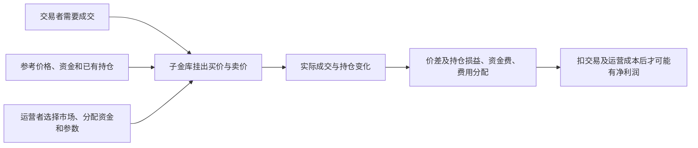

# MegaVault：公开报价与真实账本首轮核验

结论：**找到一个比“公开框架＋收益宣传”更具体的做市样本，但仍未达到“完整事前规则＋后续原账＋扣费盈利”的案例标准。** dYdX MegaVault 有官方公开报价源码、2024年发布记录，以及本次实际匿名取得的持仓快照和历史损益汇总。下一步值得核固定子金库原账；现有材料不能证明你复制后能赚钱，也不能估计可放大本金。

读取日期：北京时间2026-10-17；四份公开HTTP原件的取得时间为2026-10-16 17:03—17:09 UTC。其他网页抽取的准确请求秒数UNKNOWN，保存时间另记，不能冒充取得时间。没有使用Dune账户，不注册、不付费；只读与被动解析，没有运行来源代码、模型、回测或交易。

**钱从哪里来。** 交易者需要有人持续提供买价、卖价和可成交数量。MegaVault汇集资金，在不同永续合约市场报价；永续合约是不设固定到期日、通常通过资金费调节合约与现货价格差的合约。官方材料说明运营者分配资金、调整参数，子金库自动报价；金库的经济结果可能含交易损益、资金费、协议费用分配及激励。基金会没有运营控制这些链设施，网页不能冒充其对金库盈利的审计或担保。[基金会介绍，2024-11-12](https://www.dydx.foundation/blog/megavault-your-gateway-to-automatic-liquidity-and-yield)；[社区说明，发布日期UNKNOWN](https://docs.dydx.community/dydx/dydx-features/megavault)。

这张图是对已读规则的解释，不是XTX或MegaVault真实逐笔盈利记录。教学示例：若完整买卖一单位分别成交于99和101，且参考价值不变、其他损益为零，价差毛收益为2；若总成本为0.5则余1.5。若买入99后只能卖95，同样成本下为−4.5。报价规则能产生订单，不能保证卖出价更高。

**如何报价，已核到了什么。** 固定官方源码 `50d70ca0f151a6a40f9fa62438d6d85b583d710c` 的 `orders.go` 读取oracle参考价格、账户净值及杠杆，按价差、库存偏斜、订单层数和数量参数构造订单；持仓偏重时调整报价，close-only状态只允许减库存方向；按实际价格、数量及方向变化换撤单。这里的oracle是参考价格来源，不能直接当即时可成交价。已读函数没有展示训练模型或语言模型调用；并未审完整依赖，不能推断整个项目完全不用AI。[固定报价源码](https://github.com/dydxprotocol/v4-chain/blob/50d70ca0f151a6a40f9fa62438d6d85b583d710c/protocol/x/vault/keeper/orders.go)。

官方 `protocol/v7.0.0` 发布记录为2024-11-04，列出MegaVault和v7.0升级名；tag直接绑定 `fdb1fd329fa1b7000b07946213e26ef8872280a8`，本次取得其旧版报价源码。这支持同类规则已有早期公开版本，不能把2026年当前源码直接当2024实际执行版本；发布说明仍写release candidate，实际主网升级高度、对应历史参数和分配变更尚未取得。没有另加“必须远程证明整套构建”的门槛。[官方v7发布](https://github.com/dydxprotocol/v4-chain/releases/tag/protocol/v7.0.0)；[固定旧版报价源码](https://github.com/dydxprotocol/v4-chain/blob/fdb1fd329fa1b7000b07946213e26ef8872280a8/protocol/x/vault/keeper/orders.go)。

`AllocateToVault` 和 `SetVaultParams` 允许authority或当前operator操作；分配金额是消息输入。权限入口公开，不等于选择市场、金额和时点的完整政策已公开；本轮也未展开所有分配实现，不能断言完全靠人主观或一定存在未知私人bot。源码默认值不是历史实际值。[分配入口](https://github.com/dydxprotocol/v4-chain/blob/50d70ca0f151a6a40f9fa62438d6d85b583d710c/protocol/x/vault/keeper/msg_server_allocate_to_vault.go)；[设置参数入口](https://github.com/dydxprotocol/v4-chain/blob/50d70ca0f151a6a40f9fa62438d6d85b583d710c/protocol/x/vault/keeper/msg_server_set_vault_params.go)。

**本次确实取得的数据，而非只找到链接。**

|原件|实际结果|不能据此声称|
|---|---|---|
|官方Swagger及嵌入式OpenAPI|HTML 3467B、初始化文件254554B；仅被动提取JSON，未执行JS。49条路径，有成交、资金费、转账及金库接口。|接口声明不证明历史完整、字段含义正确或当前可匿名调用全部端点。|
|子金库当前快照|HTTP200，31753B；268条，其中194条净值非零；此次全部未出现可选perpetualPosition字段。|268笔交易、268个活跃策略、过去没有持仓或完整历史仓位。|
|整个MegaVault日损益汇总|HTTP200，13882B；84条、时间戳无重复，覆盖2026-07-19至2026-10-16。90个UTC日中少6个日期。|覆盖自成立以来全历史、逐笔净利润或可投资回报率。|

原件入口：[公开Swagger](https://indexer.dydx.trade/docs/)；[本次持仓接口](https://indexer.dydx.trade/v4/vault/v1/megavault/positions)；[本次日汇总接口](https://indexer.dydx.trade/v4/vault/v1/megavault/historicalPnl?resolution=day)。动态链接可能变化，本地保存原响应、UTC、HTTP状态和SHA-256。缺少的UTC日期为08-03、08-18、08-19、08-26、08-29及09-29；只是返回序列缺日期，不证明当日没交易或资金丢失。

末条接口报告 `equity=1728931`、`totalPnl=4691333`，不将其写成“已核净赚469万美元”。尚未核金额单位、损益计算、费用和外部现金流的完整对应；尤其不能以累计损益除当前净值计算收益率。此次子金库净值合计284142.523887与整体末条不同，源码整体还纳入主金库账户、时点/缓存也可能不同，不能仅凭差额断言账错或当成收入。

**为什么汇总不能替代原账。** 固定 `vault-controller.ts` 按服务配置的小时/日窗口查询，按起点损益调整基线，并有缓存与聚合；`getPnlTicksWithCurrentTick` 可以保留较旧tick的字段，同时填入更新净值、块高和时间。因此最新时间戳不保证所有损益字段都在同一块重新计算；固定源码是否就是服务实际运行版尚未绑定。该端点适合展示与核查入口，不能直接当逐笔会计总账。当前返回缺6日，也不能擅自补值。[控制器源码](https://github.com/dydxprotocol/v4-chain/blob/50d70ca0f151a6a40f9fa62438d6d85b583d710c/indexer/services/comlink/src/controllers/api/v4/vault-controller.ts)；[起点调整源码](https://github.com/dydxprotocol/v4-chain/blob/50d70ca0f151a6a40f9fa62438d6d85b583d710c/indexer/services/comlink/src/caches/vault-start-pnl.ts)。

OpenAPI的逐笔成交定义包含价格、数量、方向、fee、区块高度及可选builderFee/orderRouterFee等；资金费定义包含payment/rate/size；转账包含双方、数量及交易哈希。分页字段虽已声明，实际完整保留期、费用正负号和是否重复包含、所有子账户映射、原始事件对账均未核。当前快照/金库损益接口没有直接给出地址＋子账户映射，本轮没有拉取任何逐笔fills/fundingPayments/transfers，更没有从中挑盈利者。

**你能低成本学习哪一环。**

|环节|现有可学内容|缺少时的后果|
|---|---|---|
|库存约束的报价|参考价格＋买卖价差＋库存偏斜＋限量＋减仓模式，源码可阅读。|只复制“双边挂单”，可能持续接下别人不愿持有的风险；毛价差为正仍会亏。|
|参数和市场选择|可以研究公开参数与历史变更；完整选择政策尚缺。|照搬默认值不能得到运营者的收益和风险，不能称复制整套策略。|
|协议费用分配|官方资料提到协议费用分配，当前比例和资格尚待按生效规则核实；旧文50%不当当前比例。|个人自己挂单不自动获得协议对MegaVault的同等补贴；金库正收益可能不等于做市本身有优势。|
|许可和实际执行|源码是带适用法律及v4条款前置条件的AGPLv3；可研究不等于任何个人均可部署交易。数据再利用条件未核齐。|不能把源码公开当数据、地域、平台交易资格和所有依赖授权齐全；现在不需账号或凭证。|

许可依据：[官方固定LICENSE](https://github.com/dydxprotocol/v4-chain/blob/50d70ca0f151a6a40f9fa62438d6d85b583d710c/protocol/LICENSE)。本轮不作个人地域合规判断或开户建议。

研究推断：最值得学的是“先限定愿意承担的库存，再报价”，而不是先找更强模型。能否赚钱取决于实际成交后的价格变化、库存风险、资金费、费用和补贴是否覆盖损失。资金容量也取决于订单簿深度、成交选择和参数，现有数据不能给你5000美元或几十万美元的可盈利规模。

**下一步只核一条原账链。** 先从官方来源取得金库→公开地址/子账户及市场的身份映射；按事前固定市场与日历窗口取得期初/末持仓、全量成交、转账、资金费、手续费和协议分配，核对应生效版本/参数。窗口和市场须在读其表现前固定，不能在84条汇总中挑上涨时段；已有整体汇总观察事实必须保留，不能称完全盲选。先判断原件能否完整取得，再做历史原账核对，不运行策略或模拟回测。若身份/分页/账期原件无法闭合，明确保留研究样本，不用汇总替代。当前净利、可复制优势及容量均UNKNOWN。

证据目录：`evidence/dydx-megavault-rule-admission-20261017/`。根Agent负责root、报告和总台账；独立子Agent负责protocol源码/版本与复核。保留原FAILED、9400条、50股、188窗、AAPL和Issue85状态；没有改变原评价门槛。研究取得新原件属于progress，财富目标尚未达成，goal仍active。
